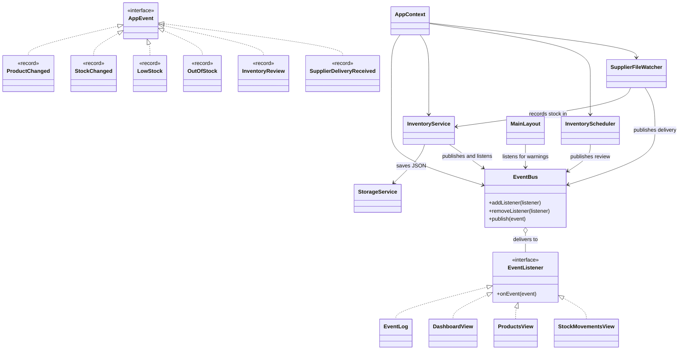

# Vent event-driven design

## What happens when someone clicks Stock Out?

1. `StockMovementsView.record` checks the selected product and quantity. The inline form's button or quantity-field Enter action is a GUI event. Ctrl+O opens `StockMovementDialog` for the same command. Both paths call `saveMovement`.
2. `AppContext.submit` puts the command on the single inventory worker so JSON reading or writing cannot freeze JavaFX.
3. `InventoryService.move` checks available stock, prepares the new product and history entry, then calls `StorageService.save`. It updates memory and publishes `StockChanged` only after the save succeeds.
4. `EventBus.publish` calls each registered listener. `InventoryService.onEvent` filters for `StockChanged` and compares the old and new quantities. A crossing to or below the threshold publishes `LowStock`; a transition to zero publishes `OutOfStock`.
5. `EventLog` records the event. The active view receives it and uses `Platform.runLater` to update JavaFX controls. `MainLayout` displays a warning toast.

## Event catalogue

These are all six custom `AppEvent` records. A view receives an event only while that screen is active.

| Event | Source | Trigger | Data carried | Handler(s) | Result |
|---|---|---|---|---|---|
| `ProductChanged` | `InventoryService` | Add, Edit, or Delete finishes saving | Product ID, name, action, time | `EventLog`; active Dashboard, Products, or Stock Movements view | Log the change and refresh the active screen. |
| `StockChanged` | `InventoryService` | Stock In or Stock Out finishes saving, from the GUI or supplier file | Product ID, name, old count, new count, threshold, IN/OUT, time | `EventLog`; `InventoryService.onEvent`; active view | Log and refresh; check whether this change causes a warning. |
| `LowStock` | `InventoryService.onEvent` | Count moves from above the threshold to a positive count at or below it | Product ID, name, new count, time | `EventLog`; `MainLayout`; active `DashboardView` | Log warning, show toast, refresh Dashboard. |
| `OutOfStock` | `InventoryService.onEvent` | Count moves from above zero to zero | Product ID, name, time | `EventLog`; `MainLayout`; active `DashboardView` | Log warning, show urgent toast, refresh Dashboard. |
| `InventoryReview` | `InventoryScheduler` | Fixed 60-second timer fires | Time | `EventLog`; active `DashboardView` | Log the scheduled review tick and refresh Dashboard. |
| `SupplierDeliveryReceived` | `SupplierFileWatcher` | Valid `.txt` file is applied and moved to `processed/` | Product ID, name, delivered count, time | `EventLog`; active `DashboardView` | Log the delivery and refresh Dashboard. |

JavaFX and the file system provide the input events that start these chains:

| Input event | Source and trigger | Handler | Result |
|---|---|---|---|
| JavaFX button/menu `ActionEvent` | Navigation, Add/Edit/Delete, Record Movement, dialog Save/Cancel, delete confirmation | `MainLayout`, `ProductsView`, `StockMovementsView`, and the dialog classes | Navigate, collect/validate input, or submit an inventory command. |
| JavaFX filter `ActionEvent` | Category or status selection changes | `ProductsView.filterChanged` | Show all matching products. |
| JavaFX keyboard event | Enter in the quantity field, or Ctrl+I / Ctrl+O | `StockMovementsView.record` or `handleShortcut` | Submit the inline form or open a stock dialog. |
| File `WatchEvent` | A `.txt` file is created or modified in `incoming/` | `SupplierFileWatcher.waitForFiles` | Send file processing to the inventory worker. |
| Scheduled callback | The 60-second executor task runs | `InventoryScheduler` | Publish `InventoryReview`. |

## Class diagram

The arrows show which classes publish events and which classes listen. The six records are defined inside `Events.java` and implement `AppEvent`.



`InventoryService` and `MainLayout` register method references or lambdas with the bus. They do not implement `EventListener` directly. The three views and `EventLog` do implement it.

## Stock Out sequence diagram

This example assumes the Stock Out crosses the low-stock threshold. If it reaches zero, the warning event is `OutOfStock` instead.

```mermaid
sequenceDiagram
    actor User
    participant View as StockMovementsView
    participant Worker as AppContext worker
    participant Service as InventoryService
    participant Storage as StorageService
    participant Bus as EventBus
    participant Log as EventLog
    participant Layout as MainLayout
    participant Active as Active view

    User->>View: Click Record Movement (Stock Out)
    View->>Worker: submit move command
    Worker->>Service: move(product ID, OUT, quantity, note)
    Service->>Service: Validate quantity and available stock
    Service->>Storage: save products and movement to JSON
    Storage-->>Service: Save succeeds
    Service->>Bus: publish StockChanged
    Bus->>Log: onEvent(StockChanged)
    Bus->>Service: onEvent(StockChanged)
    Service->>Bus: publish LowStock
    Bus->>Log: onEvent(LowStock)
    Bus->>Layout: warning listener
    Layout->>Layout: Platform.runLater(show toast)
    Bus->>Active: onEvent; Platform.runLater(refresh)
    Worker->>View: Platform.runLater(success feedback)
```

If `StorageService.save` fails, `InventoryService.move` does not update memory or publish `StockChanged`; `AppContext.submit` shows an error instead.

The scheduler uses one `ScheduledExecutorService`. The watcher uses one background thread because `WatchService.take()` waits for a file. The watcher sends inventory work to the same single worker used by GUI commands. Only `Platform.runLater` changes JavaFX controls from these background threads. The scheduler and watcher stop in `AppContext.close`.

`EventBus` has only `addListener`, `removeListener`, and `publish`. It makes a short copy of the listener list before delivery, allowing navigation to remove a view while events are being handled. A listener exception is reported and delivery continues to the next listener. Active views register in their constructors; `MainLayout.showScreen` removes the previous view listener before switching screens.

## Coursework requirement map

| Requirement | Code and demonstration |
|---|---|
| GUI event source | `MainLayout.addProduct`, `ProductsView.edit/delete`, `StockMovementsView.record`, and Ctrl+I/Ctrl+O |
| Scheduled event source | `InventoryScheduler` publishes `InventoryReview` every 60 seconds |
| External file event source | `SupplierFileWatcher` reads `incoming/*.txt`; copy `samples/supplier-delivery.txt` |
| Event chaining | `InventoryService.onEvent`: `StockChanged` to `LowStock` or `OutOfStock` |
| Event filtering | `instanceof` checks in `InventoryService`, views, `MainLayout`, and `EventLog` |
| Listener lifecycle | Views call `addListener`; `MainLayout.showScreen` calls `removeListener` |
| Responsive UI | `AppContext.submit`, watcher thread, scheduler, and view `Platform.runLater` calls |
| Persistence | `StorageService.load/save` and `InventoryService` save-before-publish operations |
| Listener failure isolation | `EventBus.publish` catches a handler exception and continues |

## Test plan

Run `mvn test`. `InventoryServiceTest` and `StorageServiceTest` cover the following, plus price and icon tests:

| # | Case | Method or manual action |
|---|---|---|
| 1 | Create and edit a product | `createsAndEditsProduct` |
| 2 | Delete while retaining history | `deletesProductButKeepsMovementHistory` |
| 3 | Stock In and Stock Out | `recordsStockInAndOut` |
| 4 | Invalid numbers and excess Stock Out | `rejectsInvalidProductAndMovementNumbers` |
| 5 | One low-stock warning on crossing | `stockChangeChainsToOneLowStockWarning` |
| 6 | Out-of-stock warning at zero | `zeroStockProducesOutOfStockWarning` |
| 7 | Listener removal | `listenerCanBeRemoved` |
| 8 | Burst of 30 ordered movements | `rapidSequentialEventsKeepCorrectBalance` |
| 9 | Review before and after another event | `unexpectedReviewOrderingDoesNotInventWarnings` |
| 10 | Failing handler does not block next handler | `failingListenerDoesNotBlockOthers` |
| 11 | JSON survives a new service instance | `jsonDataSurvivesRestart` |
| 12 | Failed storage emits no stock event | `failedSaveDoesNotChangeStockOrPublishEvent` |
| 13 | Existing, new, and invalid supplier text files using products created by the tests | `supplierFileUpdatesStockAndMovesToProcessed`, `watcherDetectsNewTextFile`, `malformedSupplierFileIsRejected` |
| 14 | Scheduled event dispatch | `scheduledReviewPublishesEvent` |
| 15 | Visual screens, dialogs, navigation, toast, and shutdown | Manual JavaFX check |

On 6 November 2026, a live supplier-file check produced a saved Stock In movement for Sugar from 24 to 124 units, and `sugar-restock.txt` moved to `processed/`. This verifies that file-drop path in the running application. The other visual checks in case 15 still need recorded evidence.

The supplier file operation is intentionally simple. If moving an already-applied file to `processed/` fails, the operator must handle that file before restarting to avoid applying it again. The recent event log is in memory; the stock movement history persists in JSON.
