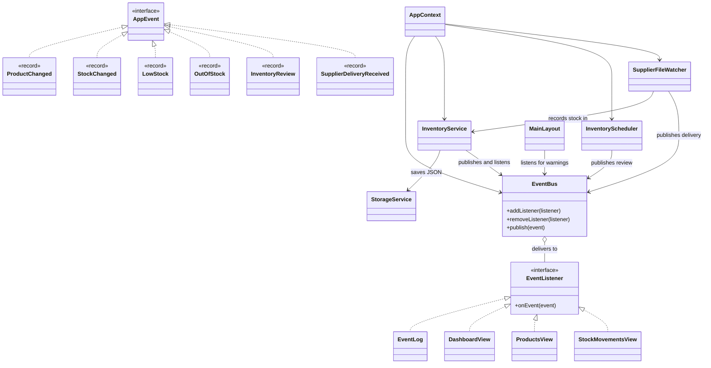

# VENT: AN EVENT-DRIVEN INVENTORY MONITOR FOR SMALL RETAIL SHOPS

Event-Driven Programming Coursework Report | Nkumba University | November 2026

**Project:** Vent, a JavaFX desktop inventory application  
**Student(s):** [Enter name(s) and registration number(s)]  
**Course unit:** Event-Driven Programming  
**Submission note:** Complete the identity details and, if submitted by a group, attach a signed contribution statement.

## Abstract

Small retailers make many stock decisions during an ordinary trading day. Deliveries add units, sales remove them, and a product can become scarce between two planned checks. Vent is a JavaFX desktop application that records products and stock movements, calculates low-stock states, and brings changes to the operator's attention. Its design uses a small event bus, six immutable Java record event types, JavaFX actions, a scheduled review, and a watched folder for supplier text files. This report analyses the problem, lists the events and handlers, traces a movement through the system, explains five event-driven techniques, and reports automated test results. The three event sources required by the coursework are present. Primary field evidence, screenshots or log extracts for the final submission, and a completed demonstration recording still need to be supplied by the student group. These limits are distinguished from verified implementation claims. The application shows how reacting to changes can make stock information timely while preserving a responsive interface and durable movement history.

## 1. Problem identification and analysis

### 1.1 The setting and the people affected

The chosen problem is visibility of stock in a small retail shop. A shopkeeper may carry dozens of product lines and handle sales, deliveries, price changes, and customer enquiries while serving people at the counter. A paper list or an occasional manual count can become stale soon after it is written. If the operator thinks an item remains available when its quantity has reached zero, a customer may be disappointed and a sale may be lost. If the operator discovers a shortage only during an end-of-day count, there is less time to reorder. Conversely, an inaccurate record may encourage buying more of a product that is already plentiful. Vent focuses on the first operational step: recording each stock movement when it occurs and showing the resulting stock status immediately.

The primary user is the owner or attendant who operates the application on a desktop or laptop. Customers are indirect beneficiaries because the attendant can answer availability questions using the recorded balance. A supplier may also benefit indirectly from more timely replenishment decisions. The system is deliberately local and single-user. It does not claim to be a point-of-sale platform, a purchasing system, or an automatic predictor of demand. These boundaries keep the solution proportionate to the coursework and make its event behaviour easier to explain and demonstrate.

The wider relevance of record keeping in Uganda is supported by the Uganda Bureau of Statistics (UBOS) Uganda National Household Survey 2019/2020. That report states that trade accounted for 47% of non-crop-farming household enterprise activities and that only 16% of household enterprises kept complete accounts. These figures are background evidence of the scale of trading and the record-keeping challenge, not a measurement of inventory errors or a survey of Vent's intended users [1]. No interview, shop observation, or locally administered questionnaire was available in the project materials. Accordingly, the specific frequency or financial cost of stock-outs in a particular Nkumba-area shop remains unmeasured. A short field validation with two or three local retailers would strengthen the problem analysis before a real deployment.

### 1.2 Observed workflow and requirements

The workflow model used for the prototype begins with a product catalogue. Each product has a name, category, unit price in Uganda shillings, current quantity, and a threshold chosen by the operator. A delivery should add a positive number of units; a sale or other stock-out should subtract a positive number and must never make the balance negative. Every movement needs a timestamp, movement type, previous balance, new balance, optional note, and product name snapshot so the history remains readable if a product is later deleted. A dashboard should summarize stock states and recent activity. Warning events should occur when a product crosses into the low-stock or out-of-stock state rather than appearing repeatedly for every subsequent movement within the same state.

Vent implements these requirements using a JavaFX dashboard, a Products view, a Stock Movements view, local JSON storage, and an in-memory technical event log. On a first run, StorageService creates `data/inventory.json` with empty product and movement lists. The operator adds real or demonstration products through the interface. Later runs load the existing file, including an intentionally empty catalogue, without replacing it. The application has no server dependency for core stock operations, although optional product photographs from web addresses need a network connection and fall back to placeholders when unavailable.

### 1.3 Goals and measurable success criteria

The principal goal is to let an attendant maintain an accurate local balance as transactions occur. A first criterion is that a valid Stock In or Stock Out updates the product balance and adds one movement record; the application tests this directly. A second criterion is that a Stock Out larger than the balance is refused without adding a movement or changing the stored quantity. A third is that crossing from In Stock into Low Stock generates one LowStock event, and reaching zero generates OutOfStock. A fourth is that a saved change survives a new service instance. A fifth is that a burst of thirty sequential movements keeps the correct final balance. A sixth is that a valid supplier text file adds stock and moves to the processed folder. The automated tests exercise these cases with temporary JSON files.

For a future shop trial, more useful user-level criteria would be: the attendant can record a typical movement in under thirty seconds; the displayed balance matches a physical count for at least 95% of a selected sample of products after one week; and the attendant can identify all products at or below their reorder threshold without checking each line manually. These are proposed evaluation thresholds, not achieved results. A further usability criterion would be that the interface remains usable while a disk write occurs. The code is structured for that through a worker executor, but no measured latency or formal usability trial is included in the repository.

### 1.4 Why events fit the problem

The important changes do not arrive in a fixed order. A supplier file may arrive before a sale or after several sales. A product may be edited after movements have been recorded. A low-stock threshold may be crossed by one large sale or several small ones. A scheduled review occurs independently of the operator's clicks. These are three kinds of event source with different timing and consequences: GUI input, a timer, and a file drop. A program that repeatedly scans every product in a busy loop would waste work while idle and still need special rules to detect state transitions. In Vent, successful commands publish domain events; subscribers update the log and active view; and a timer publishes a review event once each minute. The file watcher waits for operating-system file notifications rather than repeatedly checking a folder.

Event-driven design also clarifies responsibility. The stock service decides whether a command is valid and persists the outcome. The event bus delivers facts about successful outcomes. Views subscribe to the facts they need instead of calling one another. A stock alert handler responds only to relevant StockChanged events and decides whether a new warning should be raised. The UI thread continues to process input while file work runs elsewhere. These are practical advantages over a single sequential procedure that attempts to perform input, storage, alerting, and display updates in one long call.

## 2. Event-driven design

### 2.1 Architecture and event flow

Vent has four small parts. The JavaFX classes draw the navigation shell, dashboard, product table, movement form, and dialogs. InventoryService validates commands, while StorageService reads and writes JSON. InventoryScheduler publishes timed review events, and SupplierFileWatcher waits for supplier text files. The event package contains six record definitions in Events.java, the EventBus, the EventListener interface, and EventLog. Product and StockMovement are immutable data records. AppContext holds these objects and the single inventory worker; it also closes the scheduler and watcher when the app stops.

When a user records a movement, StockMovementsView checks the selected product and quantity, disables the button, and submits the command through AppContext. The worker invokes InventoryService.move. The service computes the new balance and movement entry, saves both through StorageService, updates memory, and publishes StockChanged. EventBus delivers the event to a simple list of listeners. InventoryService.onEvent ignores other event types and compares the old and new counts against the threshold; it publishes LowStock or OutOfStock only when the relevant boundary is crossed. EventLog records these events, while active views request JavaFX refreshes through Platform.runLater. The worker posts success feedback to the interface thread. The keyboard Stock In and Stock Out dialogs use the same save path as the inline movement form.

The order matters: a failed validation or failed save must not be announced as a successful stock change. The service publishes only after StorageService.save returns successfully. StorageService writes a temporary file and then replaces inventory.json, using an atomic move where supported and a normal replacement as fallback. This reduces the chance of leaving a partially written inventory file. Products and movements are saved together as one Data record. The service also uses synchronized methods around its mutable lists, so concurrent commands cannot read and overwrite the same starting quantity in the tested scenario.

### 2.2 Event catalogue

These are all six custom `AppEvent` records. A view receives an event only while that screen is active.

| Event | Source | Trigger | Data carried | Handler(s) | Result |
|---|---|---|---|---|---|
| `ProductChanged` | `InventoryService` | Add, Edit, or Delete finishes saving | Product ID, name, action, time | `EventLog`; active Dashboard, Products, or Stock Movements view | Log the change and refresh the active screen. |
| `StockChanged` | `InventoryService` | Stock In or Stock Out finishes saving, from the GUI or supplier file | Product ID, name, old count, new count, threshold, IN/OUT, time | `EventLog`; `InventoryService.onEvent`; active view | Log and refresh; check whether this change causes a warning. |
| `LowStock` | `InventoryService.onEvent` | Count moves from above the threshold to a positive count at or below it | Product ID, name, new count, time | `EventLog`; `MainLayout`; active `DashboardView` | Log warning, show toast, refresh Dashboard. |
| `OutOfStock` | `InventoryService.onEvent` | Count moves from above zero to zero | Product ID, name, time | `EventLog`; `MainLayout`; active `DashboardView` | Log warning, show urgent toast, refresh Dashboard. |
| `InventoryReview` | `InventoryScheduler` | Fixed 60-second timer fires | Time | `EventLog`; active `DashboardView` | Log the scheduled review tick and refresh Dashboard. |
| `SupplierDeliveryReceived` | `SupplierFileWatcher` | Valid `.txt` file is applied and moved to `processed/` | Product ID, name, delivered count, time | `EventLog`; active `DashboardView` | Log the delivery and refresh Dashboard. |

JavaFX and the file system provide the input events that start these chains:

| Input event | Source and trigger | Handler | Result |
|---|---|---|---|
| JavaFX button/menu `ActionEvent` | Navigation, Add/Edit/Delete, Record Movement, dialog Save/Cancel, delete confirmation | `MainLayout`, `ProductsView`, `StockMovementsView`, and the dialog classes | Navigate, collect/validate input, or submit an inventory command. |
| JavaFX filter `ActionEvent` | Category or status selection changes | `ProductsView.filterChanged` | Show all matching products. |
| JavaFX keyboard event | Enter in the quantity field, or Ctrl+I / Ctrl+O | `StockMovementsView.record` or `handleShortcut` | Submit the inline form or open a stock dialog. |
| File `WatchEvent` | A `.txt` file is created or modified in `incoming/` | `SupplierFileWatcher.waitForFiles` | Send file processing to the inventory worker. |
| Scheduled callback | The 60-second executor task runs | `InventoryScheduler` | Publish `InventoryReview`. |

### 2.3 Class diagram

The arrows show which classes publish events and which classes listen. The six records are defined inside `Events.java` and implement `AppEvent`.



`InventoryService` and `MainLayout` register method references or lambdas with the bus. They do not implement `EventListener` directly. The three views and `EventLog` do implement it.

### 2.4 Sequence diagram: sale crossing the threshold

This example assumes the Stock Out crosses the low-stock threshold. If it reaches zero, the warning event is `OutOfStock` instead.

```mermaid
sequenceDiagram
    actor User
    participant View as StockMovementsView
    participant Worker as AppContext worker
    participant Service as InventoryService
    participant Storage as StorageService
    participant Bus as EventBus
    participant Log as EventLog
    participant Layout as MainLayout
    participant Active as Active view

    User->>View: Click Record Movement (Stock Out)
    View->>Worker: submit move command
    Worker->>Service: move(product ID, OUT, quantity, note)
    Service->>Service: Validate quantity and available stock
    Service->>Storage: save products and movement to JSON
    Storage-->>Service: Save succeeds
    Service->>Bus: publish StockChanged
    Bus->>Log: onEvent(StockChanged)
    Bus->>Service: onEvent(StockChanged)
    Service->>Bus: publish LowStock
    Bus->>Log: onEvent(LowStock)
    Bus->>Layout: warning listener
    Layout->>Layout: Platform.runLater(show toast)
    Bus->>Active: onEvent; Platform.runLater(refresh)
    Worker->>View: Platform.runLater(success feedback)
```

If `StorageService.save` fails, `InventoryService.move` does not update memory or publish `StockChanged`; `AppContext.submit` shows an error instead.

### 2.5 Loose coupling and event-source coverage

The bus is the central dispatcher. The movement form does not know which dashboard card, toast, or log entry will react. The views implement EventListener and register with EventBus.addListener when created. MainLayout.showScreen removes the old view with removeListener before showing the next one. EventLog remains registered for the lifetime of the application. EventBus catches a RuntimeException from one listener, reports it through its error handler, and continues to the next listener. This keeps a faulty handler from suppressing other responses. The small bus delivers synchronously on the publishing thread; it does not create another queue or worker.

Vent has three event-source categories. JavaFX controls produce clicks, selections, and keyboard actions. InventoryScheduler publishes InventoryReview every sixty seconds. SupplierFileWatcher waits for new or modified `.txt` files in `incoming/` through WatchService. A file such as `4,100` means add one hundred units to product ID 4, if that ID exists. The watcher sends file processing to the same inventory worker used for GUI commands. After a valid stock change is saved, the file moves to `processed/` and SupplierDeliveryReceived is published. The separate `samples/` folder is only a safe demo template; it is not watched. The six custom event records are event types, not six independent event sources.

## 3. Java implementation and operational behaviour

### 3.1 Commands, records, and persistence

InventoryService is the boundary between UI requests and business facts. The add command rejects a blank name or category, negative price or threshold, and negative initial quantity. The update command changes descriptive fields while preserving quantity; quantity changes through movements so history remains meaningful. The move command accepts only IN or OUT, requires a positive amount, rejects an OUT amount above the available balance, and uses a wider `long` calculation to reject integer overflow on IN. These checks occur in the service even though forms also validate input. They protect the data if a supplier file or another caller invokes the service without the GUI.

Product and StockMovement are records, which suit a system where consumers should see a stable snapshot rather than mutate a shared object. StockMovement retains previous and new stock and a product-name snapshot. Deleting a catalogue entry therefore does not erase the meaning of a past transaction. The JSON file is a local persistence mechanism, not an event store: it contains the current product list and movement history. This distinction matters because the separate EventLog keeps only the latest one hundred technical entries in memory. Closing the application loses that technical log; restarting reconstructs stock from JSON, not from replaying every domain event. Consequently, the project implements an activity log, but it should not be described as event sourcing or durable event replay.

An empty first run makes the source data easy to explain: no stock exists until the operator adds a product. Creating the empty JSON file does not publish ProductChanged or StockChanged because no user transaction occurred. After that, the saved file is authoritative, even if all products are later deleted. Product IDs depend on the products already in that file; a supplier text file must use an existing ID. If inventory.json is malformed, loading fails visibly and does not overwrite it. The local inventory data already present before this change remains untouched and will continue to load normally.

### 3.2 Threading and responsiveness

JavaFX requires scene-graph updates on its application thread. AppContext.submit places GUI inventory commands on one ExecutorService worker and posts success or error callbacks with Platform.runLater. The supplier watcher uses that same worker for file processing, so GUI and supplier stock writes are processed one at a time. The watcher itself has one background thread because WatchService.take blocks while waiting for a file. The scheduler has one daemon ScheduledExecutorService, publishing InventoryReview after sixty seconds and every sixty seconds thereafter. View listeners post refreshes to JavaFX rather than changing controls from a worker. InventoryService uses synchronized methods so UI reads and worker writes see consistent lists. AppContext.close stops the watcher and scheduler and shuts down the worker.

The custom bus does not introduce its own queue. EventBus keeps an ArrayList of EventListener objects. Its publish method briefly copies that list, then calls each listener's onEvent method. Each listener checks the event type with `instanceof` and ignores irrelevant events. This is simple for the small number of listeners in Vent. It means a slow listener can delay its publisher, and a listener can publish a second event before the first publish returns. The alert chain is deliberately shallow: StockChanged may produce one warning, but warning listeners do not issue another stock command.

The GUI also prevents some avoidable duplicate actions. The movement button is disabled while its submitted command is pending, and it is re-enabled after success or error. In the ProductDialog, a JavaFX event filter consumes the Save action if required fields are invalid, leaving the dialog open for correction. This is event consumption at the framework level. Invalid optional image links do not block inventory work; they result in a placeholder. These details make the program usable while preserving the event model's separation between input events and saved domain facts.

### 3.3 User interface and demonstration path

The dashboard presents counts and recent technical events, including scheduled review entries. Products supports catalogue changes and filtering, with all matching products shown in one table rather than paginated. Stock Movements has an inline form and history table; Ctrl+I and Ctrl+O open separate Stock In and Stock Out dialogs. Both input routes call StockMovementsView.saveMovement. For a fresh-run demonstration, add a product with quantity twelve and threshold ten. Stock Out of four units leaves eight and triggers LowStock. A second small Stock Out leaves it low without repeating the warning. Recording the remaining units out triggers OutOfStock. Leaving the application open for sixty seconds shows an Inventory review entry.

This is a demonstration script, not a claim that a recorded video or live presentation has been completed. A saved inventory may differ from the fresh-run example, so the team should choose a product and check its current quantity and threshold before rehearsing. The coursework requires a live session or a three-to-five-minute video. The script illustrates the causal sequence most likely to be discussed in the viva: a JavaFX action leads to a service command, persistence, a StockChanged event, a type-and-threshold check, a warning event, a log entry, and a JavaFX refresh. The supplier file provides a second short demonstration: after adding a product, drop a valid `.txt` file with that product's ID into `incoming/` while Vent runs and show its movement into `processed/` and the updated balance.

## 4. Event-driven techniques applied

### 4.1 Chaining without repeated alerts

The first technique is controlled event chaining. InventoryService.move publishes StockChanged after a successful save. The service registered its onEvent method with the bus when it was created. That method ignores events other than StockChanged. For a stock change, it compares the previous and new quantities. If the new count is zero and the previous count was not, it publishes OutOfStock. If the new count is positive but at or below the threshold while the previous count was above the threshold, it publishes LowStock. There is no separate alert-state map. Thus a second sale while an item is already low does not create another LowStock warning, but a receipt above the threshold followed by a later crossing can warn again.

This chain has a natural stop condition. LowStock and OutOfStock are observed by the log, MainLayout toast handler, and active Dashboard, but no warning handler changes stock or republishes StockChanged. There is no recursive cycle in the present graph. The low-stock and out-of-stock tests verify the boundary conditions. A future handler that publishes another stock command should be reviewed for possible event loops.

### 4.2 Filtering and consuming

The second technique is event filtering. EventBus sends every AppEvent to each registered listener, and the listener chooses what matters. InventoryService.onEvent uses `instanceof Events.StockChanged` before checking the old and new counts. DashboardView responds to product, stock, warning, review, and supplier-delivery events; ProductsView and StockMovementsView respond only to product and stock changes. MainLayout responds only to LowStock and OutOfStock. These checks are easy to find and change during an oral defence. The bus itself stays small: it does not contain business rules or a generic predicate system.

JavaFX's event filter gives a second example. ProductDialog attaches an ActionEvent filter to Save. If a required field is invalid, the filter consumes that Save action and shows an error message. The dialog remains open for correction. StockMovementDialog similarly checks a positive whole quantity and rejects an oversized Stock Out. These checks concern input; the service repeats essential validation so a supplier file cannot bypass stock rules.

### 4.3 Listener lifecycle management

The third technique is explicit listener lifecycle management. DashboardView, ProductsView, and StockMovementsView implement EventListener and call EventBus.addListener when created. MainLayout.showScreen calls EventBus.removeListener on the old active view before creating the next view. This prevents duplicate refreshes and discarded view objects staying reachable through the bus. InventoryService, EventLog, and the MainLayout warning listener remain for the application lifetime. The listener-removal test registers a listener, removes it, then checks that it receives no later event.

### 4.4 Scheduled events

The fourth technique is scheduled event generation. InventoryScheduler calls ScheduledExecutorService.scheduleAtFixedRate with an initial delay of sixty seconds and a period of sixty seconds. Its daemon thread publishes InventoryReview with a timestamp. EventLog records the review tick, and the active Dashboard refreshes. The scheduled event is independent of button clicks and supplier files; there is no busy polling loop. Oracle's API describes scheduleAtFixedRate as enabling periodic actions after a chosen initial delay [3].

The present InventoryReview handler does not rescan products or generate warnings. StockChanged handles warnings immediately after each saved movement, including supplier deliveries. The review event demonstrates a timed source and produces a visible log entry. Calling it a scheduled review tick is more precise than claiming that it recalculates balances. The scheduler also schedules the removal of warning toasts after four seconds, without a page or toast animation timeline.

### 4.5 Keeping the interface responsive

The fifth technique, beyond the requested minimum of four, is off-thread command processing with safe UI handoff. AppContext submits file operations to a single background worker. It posts completion and errors with Platform.runLater. JavaFX documentation states that runLater places a Runnable on the application event queue and returns immediately; it advises doing long work off the application thread and avoiding excessive queued UI tasks [2]. In Vent, this prevents a disk write from blocking button clicks and screen painting in the usual case. Each bus subscriber that refreshes a view posts its work to the JavaFX thread rather than mutating controls from the worker or scheduler thread.

There are limits to this responsiveness claim. The project does not measure frame time during a slow disk, and every event can queue a refresh, so a very large burst may queue many UI updates. The rapid-change test verifies state consistency, not rendered frame rate. Vent deliberately does not implement batching, back-pressure, or priority dispatch because they are unnecessary for this small coursework application.

## 5. Testing, results, and demonstration

### 5.1 Test approach and evidence

The project uses JUnit 5 tests run by Maven. InventoryService tests use temporary JSON files rather than the demonstration data file. They assert both state and emitted-event behaviour. On 7 November 2026, `mvn clean test` completed with 26 tests, zero failures, and zero errors across four Surefire test suites. The table names representative checks from that run. This is evidence for those code paths, not a claim that all JavaFX interactions were automated.

| ID | Scenario and expected result | Actual result and evidence |
|---|---|---|
| T01 | Create and edit a product; the edit keeps its quantity. | Passed: `createsAndEditsProduct`. |
| T02 | Delete a product while keeping its movement history. | Passed: `deletesProductButKeepsMovementHistory`. |
| T03 | Record Stock In and Stock Out. | Passed: `recordsStockInAndOut`. |
| T04 | Reject invalid product values, zero movement quantity, and excessive Stock Out. | Passed: `rejectsInvalidProductAndMovementNumbers`. |
| T05 | Cross into low stock and make another low-state movement; only one warning occurs. | Passed: `stockChangeChainsToOneLowStockWarning`. |
| T06 | Reach zero stock; one OutOfStock warning occurs. | Passed: `zeroStockProducesOutOfStockWarning`. |
| T07 | Remove a listener; it does not receive the next event. | Passed: `listenerCanBeRemoved`. |
| T08 | Send thirty rapid sequential Stock In commands; balance and history match. | Passed: `rapidSequentialEventsKeepCorrectBalance`. |
| T09 | Send review events before and after product creation; no invented warning appears. | Passed: `unexpectedReviewOrderingDoesNotInventWarnings`. |
| T10 | Make one listener fail; a later listener still receives the event. | Passed: `failingListenerDoesNotBlockOthers`. |
| T11 | Reload saved products and movements from JSON. | Passed: `jsonDataSurvivesRestart`. |
| T12 | Fail a storage save; stock and events remain unchanged. | Passed: `failedSaveDoesNotChangeStockOrPublishEvent`. |
| T13 | Process an existing valid supplier text file and move it to `processed/`. | Passed: `supplierFileUpdatesStockAndMovesToProcessed`. |
| T14 | Reject a malformed supplier text file without changing stock. | Passed: `malformedSupplierFileIsRejected`. |
| T15 | Detect a new supplier text file while the watcher is running. | Passed: `watcherDetectsNewTextFile`. |
| T16 | Publish a scheduled review event. | Passed: `scheduledReviewPublishesEvent`. |
| T17 | Start with an empty catalogue, preserve added products and movements, and reject malformed existing JSON. | Passed: `StorageServiceTest` cases. |

These actual results cover the coursework's requested burst, unexpected-order, and handler-failure cases. T08 uses thirty ordered movements, not six concurrent test threads: the single inventory worker is the intended command model. T09 probes a timer event arriving before a product exists. T10 verifies that EventBus continues after a handler throws. The automated tests do not launch JavaFX, so they do not directly measure UI frame time or visually inspect navigation, dialogs, and toasts. The live presentation should check those interactions.

An actual supplier-file demonstration on 6 November 2026 produced this movement in `data/inventory.json` after `sugar-restock.txt` was dropped into `incoming/`. The file then appeared in `processed/`:

```text
productId: 4, productName: Sugar (1 kg), type: IN, quantity: 100
previousStock: 24, newStock: 124
note: Supplier delivery: sugar-restock.txt
```

This is a short extract of the persisted movement record, not a screenshot. The operator reported that the live file drop updated the visible application. The technical Dashboard event log is in memory; movement history in JSON persists. A screenshot of the Dashboard, movement table, warning toast, and timed review remains useful for the final submission, and no screenshot is claimed here.

### 5.2 Demonstration plan and interpretation

A three-to-five-minute demonstration can be organized around one product. First, show the empty Dashboard on a fresh installation. Add a product with quantity twelve and low-stock threshold ten. Open Stock Movements and record Stock Out of four units to cross below the threshold. Show the warning toast, changed balance, and movement history. Record another small Stock Out to show the warning is not repeated while the item remains low. Finally, take the remaining units out to trigger OutOfStock. Show a scheduled review entry after sixty seconds if time allows. For the third source, drop a supplier text file that names an existing product ID into `incoming/` and show it in `processed/` afterward. Close and reopen the application to show that products and movements persist.

The presenter should distinguish technical event-log entries from persisted movement records and point to the relevant source files. They should show all three event sources: GUI action, scheduler tick, and supplier text file. A useful viva exercise is to change a low-stock threshold and predict whether a future StockChanged event will cross it. Another is to navigate away from a view and explain why it no longer receives callbacks. These questions test understanding of sources, payloads, filtering, lifecycle, threading, and persistence rather than simply showing attractive screens.

## 6. Java benchmark: reflection and comparison

Java supplies concrete mechanisms for each event-driven idea in Vent. `Events.java` declares six records: ProductChanged, StockChanged, LowStock, OutOfStock, InventoryReview, and SupplierDeliveryReceived. Records are useful because an event is a fixed set of facts about something that happened, such as a product ID, new quantity, and time. The records implement the small AppEvent marker interface. EventListener has one method, `onEvent(AppEvent event)`. The custom EventBus keeps a list of these listeners and offers `addListener`, `removeListener`, and `publish`. A view or service uses `instanceof` to decide which records it handles. This is an observer-style design without the deprecated `java.util.Observable` and without a generic subscription framework.

JavaFX supplies the framework input events. A Button's `setOnAction` handler turns a click into a command. The movement form also accepts Enter in the quantity field, while Ctrl+I and Ctrl+O open separate stock dialogs. ProductDialog consumes an invalid Save action so the dialog stays open. JavaFX has its own application thread for controls. A disk write on that thread could freeze button clicks and repainting, so AppContext submits inventory commands to a single ExecutorService worker. `Platform.runLater` sends success, error, and refresh callbacks back to JavaFX. The worker processes GUI and supplier commands in order, making stock changes easier to reason about than several parallel writers.

The other two sources use standard Java facilities. InventoryScheduler uses ScheduledExecutorService to publish InventoryReview every sixty seconds. SupplierFileWatcher uses WatchService to wait for a new or modified `.txt` file in `incoming/`; this blocking wait runs on its own thread. When a file arrives, the watcher hands parsing and stock changes to the inventory worker. Its simple `ID,quantity` format is only a simulated external input. The watcher validates the ID and amount before using InventoryService.move, then moves a successful file to `processed/` and publishes SupplierDeliveryReceived. The sample file stays outside the watched folder until the demonstrator copies it. This shows a third source without a network server or message broker.

One subtle aspect is that EventBus delivers synchronously. When InventoryService.move publishes StockChanged from the worker, the bus calls listeners on that same worker. InventoryService.onEvent may then publish LowStock before the original publish finishes. `Platform.runLater` is what makes the resulting UI update asynchronous and safe for JavaFX. EventBus briefly copies its listener list before delivery, allowing a view to be removed while events are being handled. It catches a failing listener's RuntimeException and continues to the next listener. These small rules are testable: tests check warning generation, listener removal, and failure isolation.

JavaScript offers a comparison. A browser click callback and timer callback run through an event loop, and ordinary DOM updates belong on the browser's main thread. JavaFX similarly has an application thread for interface changes. JavaScript often uses promises or `async` functions for operations that should not block interaction. Vent instead uses an ExecutorService worker and explicitly hands UI work back with `Platform.runLater`. One advantage of Java here is that record payloads and method signatures make the event data clear to the compiler and easy to inspect in a test. One limitation is the amount of thread and lifecycle code needed even for a small desktop app: the programmer must close the watcher and scheduler, remove inactive view listeners, and avoid touching controls from background threads. The key lesson is to distinguish event creation, delivery, business state change, and UI update. Those steps are connected, but they are not the same method or thread.

## 7. Evaluation and conclusion

Vent addresses a practical stock-recording problem with a small, inspectable Java application. A saved movement changes the balance, produces an event record, updates listeners, and can cause a warning when stock crosses a threshold. The service rejects invalid stock-outs and writes products and movements together. Event listeners are removable, a failing listener does not block later ones, and scheduled reviews occur without a busy loop. A supplier text file adds the required third source. Twenty-six passing automated tests cover empty first-run storage, core rules, persistence, bursts, unusual ordering, handler failure, scheduled dispatch, and supplier-file processing. A live supplier-file run also produced a saved movement from 24 to 124 units of Sugar in an existing inventory.

The evaluation has clear boundaries. No field interview, shop observation record, screenshot, or completed demonstration video has been supplied with this report. The technical event log is volatile and limited to one hundred entries; products and stock movements are durable in JSON. The scheduled review currently logs a timed tick rather than rescanning stock. A supplier file that is applied but cannot be moved to `processed/` could be retried after a restart, so the operator must resolve that rare file-move failure before restarting. The software remains a local single-user tool; it does not coordinate multiple devices editing the same JSON file. These limits should be explained during the defence rather than hidden.

The central design conclusion is that stock control is naturally triggered by occurrences: sales, deliveries, edits, and timed ticks. Vent's event records and listeners let these occurrences update the relevant parts of the system while keeping stock rules in InventoryService. Java records, a small listener interface, an executor, a scheduler, WatchService, and the JavaFX event queue provide a clear benchmark for explaining that design. Before submission, the team should add primary problem evidence, capture final screenshots or log extracts from the demonstration, rehearse the live or video presentation, and sign the group contribution statement.

## References

[1] Uganda Bureau of Statistics, *Uganda National Household Survey 2019/2020 Report*, 2021, https://www.ubos.org/wp-content/uploads/publications/09_2021Uganda-National-Survey-Report-2019-2020.pdf (accessed 5 November 2026).

[2] OpenJFX, *Platform (JavaFX API): runLater*, https://openjfx.io/javadoc/17/javafx.graphics/javafx/application/Platform.html (accessed 5 November 2026).

[3] Oracle, *ScheduledExecutorService (Java Platform SE API)*, https://docs.oracle.com/javase/8/docs/api/java/util/concurrent/ScheduledExecutorService.html (accessed 5 November 2026).

[4] Vent project, *README.md, EVENT_DRIVEN_DESIGN.md, Java source, JUnit tests, and Surefire test reports*, local coursework repository, reviewed 6 November 2026.

## Appendix A. Key source locations for oral defence

Events.java defines six event records. AppEvent.java and EventListener.java define the two small interfaces. EventBus.java stores listeners and handles delivery and failure isolation. InventoryService.java validates commands, saves changes, publishes StockChanged, and chains threshold warnings. InventoryScheduler.java raises timed review events. SupplierFileWatcher.java watches incoming text files and sends valid deliveries to the inventory worker. AppContext.java owns that worker and closes the scheduler and watcher. ProductDialog.java and StockMovementDialog.java collect input. MainLayout.java removes inactive view listeners during navigation. DashboardView.java, ProductsView.java, and StockMovementsView.java refresh through JavaFX. StorageService.java handles JSON persistence and creates empty first-run data. InventoryServiceTest.java and StorageServiceTest.java provide the main behaviour and persistence evidence.

## Appendix B. Group contribution statement template

If submitted by a group, list each member's name and registration number, the design, implementation, testing, writing, and presentation tasks they completed, and a dated signature for every member. This template is intentionally unsigned and does not claim contributions that were not supplied to the report writer.
